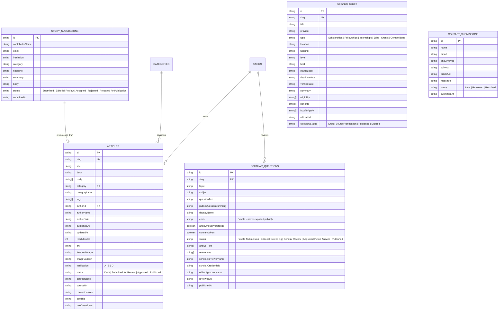

# D2J Media Hub — Content Model & Database Schema

This document defines the data entities, relationships, editorial workflows, and PostgreSQL/Supabase migration schema for **D-Path to Jannah Media Hub (D2J Media Hub)**.

---

## 1. Core Entities & Relationships



---

## 2. PostgreSQL / Supabase SQL Schema

When migrating from the local JSON relational store (`data/db.json`) to managed PostgreSQL / Supabase, execute the following DDL migration:

```sql
CREATE TABLE categories (
  slug TEXT PRIMARY KEY,
  name TEXT NOT NULL,
  description TEXT NOT NULL,
  topics TEXT[] DEFAULT '{}'
);

CREATE TABLE users (
  id TEXT PRIMARY KEY,
  name TEXT NOT NULL,
  email TEXT UNIQUE NOT NULL,
  role TEXT NOT NULL CHECK (role IN ('SUPER_ADMIN', 'ADMINISTRATOR', 'EDITOR', 'CONTRIBUTOR', 'SCHOLAR')),
  title TEXT NOT NULL,
  password_hash TEXT NOT NULL,
  active BOOLEAN DEFAULT TRUE,
  is_super_admin BOOLEAN DEFAULT FALSE,
  permissions TEXT[] DEFAULT '{}',
  allowed_categories TEXT[] DEFAULT '{ALL}',
  last_login_at TIMESTAMPTZ,
  created_at TIMESTAMPTZ DEFAULT NOW()
);

CREATE TABLE admin_activity_logs (
  id TEXT PRIMARY KEY,
  actor_id TEXT REFERENCES users(id),
  actor_name TEXT NOT NULL,
  actor_email TEXT NOT NULL,
  actor_role TEXT NOT NULL,
  action TEXT NOT NULL,
  target_type TEXT NOT NULL,
  target_id TEXT,
  target_title TEXT NOT NULL,
  status_change TEXT,
  details TEXT,
  super_admin_review_status TEXT DEFAULT 'Pending Review',
  super_admin_review_note TEXT,
  reviewed_by_super_admin TEXT,
  reviewed_at DATE,
  created_at TIMESTAMPTZ DEFAULT NOW()
);

CREATE TABLE articles (
  id TEXT PRIMARY KEY,
  slug TEXT UNIQUE NOT NULL,
  title TEXT NOT NULL,
  deck TEXT NOT NULL,
  body JSONB NOT NULL DEFAULT '[]',
  category TEXT REFERENCES categories(slug),
  category_label TEXT NOT NULL,
  tags TEXT[] DEFAULT '{}',
  author_id TEXT,
  author_name TEXT NOT NULL,
  author_role TEXT NOT NULL,
  published_at DATE NOT NULL,
  updated_at DATE,
  read_minutes INT DEFAULT 4,
  art TEXT DEFAULT 'news',
  featured_image TEXT,
  image_caption TEXT NOT NULL,
  verification TEXT NOT NULL CHECK (verification IN ('A', 'B', 'D')),
  status TEXT NOT NULL CHECK (status IN ('Draft', 'Submitted for Review', 'Approved', 'Published')),
  source_name TEXT,
  source_url TEXT,
  correction_note TEXT,
  seo_title TEXT,
  seo_description TEXT
);

CREATE TABLE opportunities (
  id TEXT PRIMARY KEY,
  slug TEXT UNIQUE NOT NULL,
  title TEXT NOT NULL,
  provider TEXT NOT NULL,
  type TEXT NOT NULL,
  location TEXT NOT NULL,
  funding TEXT NOT NULL,
  level TEXT NOT NULL,
  field TEXT NOT NULL,
  status_label TEXT NOT NULL,
  deadline_note TEXT NOT NULL,
  verified_date DATE NOT NULL,
  summary TEXT NOT NULL,
  eligibility JSONB NOT NULL DEFAULT '[]',
  benefits JSONB NOT NULL DEFAULT '[]',
  how_to_apply JSONB NOT NULL DEFAULT '[]',
  official_url TEXT NOT NULL,
  workflow_status TEXT NOT NULL CHECK (workflow_status IN ('Draft', 'Source Verification', 'Published', 'Expired')),
  verification TEXT NOT NULL DEFAULT 'A'
);

CREATE TABLE scholar_questions (
  id TEXT PRIMARY KEY,
  slug TEXT UNIQUE NOT NULL,
  topic TEXT NOT NULL,
  subject TEXT NOT NULL,
  question_text TEXT NOT NULL,
  public_question_summary TEXT,
  display_name TEXT,
  email TEXT,
  anonymous_preference BOOLEAN DEFAULT TRUE,
  consent_given BOOLEAN NOT NULL DEFAULT TRUE,
  submitted_at TIMESTAMPTZ DEFAULT NOW(),
  status TEXT NOT NULL CHECK (status IN ('Private Submission', 'Editorial Screening', 'Scholar Review', 'Approved Public Answer', 'Published')),
  answer_text JSONB DEFAULT '[]',
  references_list JSONB DEFAULT '[]',
  scholar_reviewer_name TEXT,
  scholar_credentials TEXT,
  editor_approver_name TEXT,
  reviewed_at DATE,
  published_at DATE,
  is_demo BOOLEAN DEFAULT FALSE
);

CREATE TABLE story_submissions (
  id TEXT PRIMARY KEY,
  contributor_name TEXT NOT NULL,
  email TEXT NOT NULL,
  institution TEXT,
  location TEXT,
  phone TEXT,
  category TEXT NOT NULL,
  headline TEXT NOT NULL,
  summary TEXT NOT NULL,
  body TEXT NOT NULL,
  preferred_byline TEXT,
  source_links TEXT,
  attachments JSONB DEFAULT '[]',
  consent_given BOOLEAN NOT NULL DEFAULT TRUE,
  submitted_at TIMESTAMPTZ DEFAULT NOW(),
  status TEXT NOT NULL CHECK (status IN ('Submitted', 'Editorial Review', 'Accepted', 'Rejected', 'Prepared for Publication')),
  editor_notes TEXT
);

CREATE TABLE contact_submissions (
  id TEXT PRIMARY KEY,
  name TEXT NOT NULL,
  email TEXT NOT NULL,
  enquiry_type TEXT NOT NULL,
  organisation TEXT,
  subject TEXT,
  article_url TEXT,
  message TEXT NOT NULL,
  submitted_at TIMESTAMPTZ DEFAULT NOW(),
  status TEXT NOT NULL CHECK (status IN ('New', 'Reviewed', 'Resolved'))
);
```
